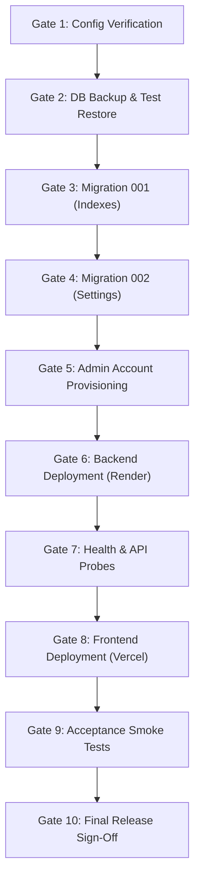

# CIME Campus Management System (CIME CMS)
## Phase 3B: Production Release Safety & Readiness Plan

**Document Version:** 1.0.0  
**Project:** CIME Campus Management System (CIME CMS)  
**Repository:** `E:\CIME-ERP-dev`  
**Target Branch:** `development` (Merging to `main` for release)  
**Audited HEAD Commit:** `7117cdb446c4d7b3c1c694eed83233fae0c23809`  
**Hosting Platforms:** Render (`backend`), Vercel (`frontend`), MySQL 8.0 (`database`)  
**Mode:** READ-ONLY Verification & Operational Release Governance

---

## 1. Executive Summary

This document establishes the verified operational release plan and safety controls for deploying the CIME Campus Management System to production. 

All underlying application code has completed Phase 1 (database indexing schema, settings persistence, aggregated reporting, health probes), Phase 2A (student data authorization hardening and registration disablement), Phase 2B (CORS allowlisting, Render proxy auto-detection, mailer log sanitization, login loop prevention), and Phase 2C (avatar CSS injection elimination via gradient whitelisting). The backend regression test suite passes 100% (**66/66 tests passed**).

This Phase 3B release plan ensures that:
1. Database migrations (001 and 002) are executed idempotently with zero risk of aborting on duplicate keys.
2. Production data is protected via a verified snapshot and dry-run restoration protocol.
3. The initial administrator account is provisioned securely without invoking destructive seed scripts.
4. Render and Vercel cloud configurations eliminate routing and environment mismatches prior to cutover.
5. Production release progresses through **ten discrete approval gates**, each with strict rollback criteria.

---

## 2. Phase 3A Findings Summary

| Area | Status | Critical Finding | Mandatory Pre-Release Requirement |
| :--- | :---: | :--- | :--- |
| **Backend Code** | **PASS** | 66/66 automated tests pass; linear git history; clean working tree. | Commit `7117cdb` approved for production merge. |
| **Render Web Service** | **ACTION REQUIRED** | Render requires discrete `DB_*` variables and `FRONTEND_URL` to prevent email links defaulting to `localhost:5000`. | Configure Render environment variables before backend deploy. |
| **Vercel Frontend** | **ACTION REQUIRED** | Project root must be set to `frontend` (not repository root) to serve `index.html`. | Configure Root Directory in Vercel project settings. |
| **Migration 001** | **ACTION REQUIRED** | `CREATE INDEX` will fail with `ERROR 1061` if any index already exists. | Execute preflight index detection before running Migration 001. |
| **Migration 002** | **ACTION REQUIRED** | Backend endpoints (`/settings/*`, PDF reports) return HTTP 503/500 if table is missing. | Execute Migration 002 prior to deploying backend code. |
| **Admin Provisioning** | **CRITICAL WARNING** | `backend/seed.js` resets passwords to `'password'` and injects mock students. | Never run `seed.js` in production; use isolated SQL insert. |

---

## 3. Migration Safety Review (Task 1)

### 3.1 Migration 001: Performance Indexes (`001_performance_indexes.sql`)

#### A. Expected Database Objects
- `students (department, semester)` -> `idx_students_dept_sem`
- `students (created_at)` -> `idx_students_created`
- `students (status)` -> `idx_students_status`
- `attendance (date, status)` -> `idx_attendance_date_status`

#### B. Schema Compatibility Analysis
- In `database/schema.sql`, lines 26–28 and line 38 already define these exact four index signatures.
- **Risk:** If the production database was initialized using `schema.sql`, running `001_performance_indexes.sql` directly will fail with `ERROR 1061 (42000): Duplicate key name 'idx_students_dept_sem'`.
- MySQL 8.0 does not support `CREATE INDEX IF NOT EXISTS`.

#### C. Recommended Safe SQL Implementation
To ensure repeatable, idempotent execution without manual statement selection, use an idempotent stored procedure wrapper:

```sql
-- ============================================================
-- IDEMPOTENT RUNNER FOR MIGRATION 001
-- ============================================================
DELIMITER $$
DROP PROCEDURE IF EXISTS CreateIndexIfNotExists$$
CREATE PROCEDURE CreateIndexIfNotExists(
    IN p_table_name VARCHAR(64),
    IN p_index_name VARCHAR(64),
    IN p_index_columns VARCHAR(255)
)
BEGIN
    IF NOT EXISTS (
        SELECT 1 FROM INFORMATION_SCHEMA.STATISTICS
        WHERE TABLE_SCHEMA = DATABASE()
          AND TABLE_NAME = p_table_name
          AND INDEX_NAME = p_index_name
    ) THEN
        SET @s = CONCAT('CREATE INDEX ', p_index_name, ' ON ', p_table_name, ' (', p_index_columns, ')');
        PREPARE stmt FROM @s;
        EXECUTE stmt;
        DEALLOCATE PREPARE stmt;
        SELECT CONCAT('Created index: ', p_index_name) AS status;
    ELSE
        SELECT CONCAT('Index already exists: ', p_index_name) AS status;
    END IF;
END$$
DELIMITER ;

CALL CreateIndexIfNotExists('students', 'idx_students_dept_sem', 'department, semester');
CALL CreateIndexIfNotExists('students', 'idx_students_created', 'created_at');
CALL CreateIndexIfNotExists('students', 'idx_students_status', 'status');
CALL CreateIndexIfNotExists('attendance', 'idx_attendance_date_status', 'date, status');

DROP PROCEDURE IF EXISTS CreateIndexIfNotExists;
```

#### D. Rollback Safety
Rollback strictly targets only the four indexes created:
```sql
ALTER TABLE students DROP INDEX IF EXISTS idx_students_dept_sem;
ALTER TABLE students DROP INDEX IF EXISTS idx_students_created;
ALTER TABLE students DROP INDEX IF EXISTS idx_students_status;
ALTER TABLE attendance DROP INDEX IF EXISTS idx_attendance_date_status;
```
*Impact:* Zero table data is deleted or altered; only query optimization indexes are removed.

---

### 3.2 Migration 002: Institutional Settings (`002_institutional_settings.sql`)

#### A. Expected Database Objects
- Table: `institutional_settings`
- Columns: `id (INT PK)`, `institution_name (VARCHAR 255)`, `academic_year (VARCHAR 50)`, `time_zone (VARCHAR 50)`, `contact_email (VARCHAR 255)`, `updated_at (TIMESTAMP)`, `updated_by (VARCHAR 36 FK -> users.id)`.
- Constraints:
  - `chk_singleton_id`: `CHECK (id = 1)`
  - `fk_inst_settings_updated_by`: `FOREIGN KEY (updated_by) REFERENCES users(id) ON DELETE SET NULL`
- Default Seed: `id = 1` initialized via `INSERT IGNORE`.

#### B. Schema Compatibility & Data Preservation
- Uses `CREATE TABLE IF NOT EXISTS` -> safe if table already created.
- Uses `INSERT IGNORE INTO institutional_settings (id, ...) VALUES (1, ...)` -> **100% data-preserving**. If an administrator has already configured custom college names or academic years, `INSERT IGNORE` leaves the row untouched.
- Singleton constraint `CHECK (id = 1)` guarantees only one global configuration row can exist.
- Foreign key `ON DELETE SET NULL` ensures that deleting an administrative user account will not cascade or delete the institutional settings row.

#### C. Repeatability & Rollback Safety
- **Repeatability:** Fully idempotent. Can be executed multiple times without error or state change.
- **Rollback SQL:**
  ```sql
  DROP TABLE IF EXISTS institutional_settings;
  ```
  *Impact:* Strictly drops the settings table. No other institutional tables (`students`, `attendance`, `grades`, `users`, `audit_logs`) are affected.

---

## 4. Backup and Recovery Strategy (Task 2)

### 4.1 Production Backup Checklist (Pre-Release)
The database snapshot must be executed before applying any migration or code deployment:

```bash
# 1. Execute transactional snapshot
mysqldump -h <DB_HOST> -P <DB_PORT> -u <DB_USER> -p <DB_NAME> \
  --single-transaction \
  --quick \
  --routines \
  --triggers \
  --hex-blob \
  > /var/backups/cime/cime_prod_pre_release_$(date +%Y%m%d_%H%M%S).sql

# 2. Check file size (must be > 0 bytes)
ls -lh /var/backups/cime/cime_prod_pre_release_*.sql

# 3. Check termination marker (must verify dump finished cleanly)
tail -n 2 /var/backups/cime/cime_prod_pre_release_*.sql | grep "Dump completed"

# 4. Compute SHA-256 integrity hash
sha256sum /var/backups/cime/cime_prod_pre_release_*.sql > /var/backups/cime/snapshot.sha256
```

### 4.2 Dry-Run Restoration Verification
Before approving migrations, verify backup validity by restoring into an isolated temporary database:

```sql
-- In MySQL administrative console:
CREATE DATABASE cime_restore_verify;
```

```bash
# In terminal:
mysql -h <DB_HOST> -P <DB_PORT> -u <DB_USER> -p cime_restore_verify < /var/backups/cime/cime_prod_pre_release_*.sql
```

```sql
-- Verification query across restored database:
SELECT 'students' AS tbl, COUNT(*) AS total FROM cime_restore_verify.students UNION ALL
SELECT 'attendance', COUNT(*) FROM cime_restore_verify.attendance UNION ALL
SELECT 'grades', COUNT(*) FROM cime_restore_verify.grades UNION ALL
SELECT 'users', COUNT(*) FROM cime_restore_verify.users UNION ALL
SELECT 'audit_logs', COUNT(*) FROM cime_restore_verify.audit_logs;

-- Confirm counts match live production table counts 100%, then clean up:
DROP DATABASE cime_restore_verify;
```

### 4.3 Recovery Limitations & Rollback Decision Points
- **Point 1 (Migration Failure):** If Migration 001 or 002 fails during execution, execute the respective `DROP INDEX` or `DROP TABLE` statement. No restore required.
- **Point 2 (Backend Startup Failure):** If the new backend deployment crashes due to missing environment variables or DB connection errors, roll back to previous commit in the Render Web Service dashboard (1-click instant rollback).
- **Point 3 (Data Corruption):** If data corruption occurs post-cutover, immediately place the frontend in maintenance mode, stop backend traffic, and execute full snapshot restoration:
  ```bash
  mysql -h <DB_HOST> -P <DB_PORT> -u <DB_USER> -p <DB_NAME> < /var/backups/cime/cime_prod_pre_release_*.sql
  ```

---

## 5. Administrator Provisioning Safety (Task 3)

### 5.1 Security Requirements
- **No Overwriting:** Must never clobber an existing administrator password hash.
- **No Insecure Backdoors:** Default passwords (e.g. `'password'`) are strictly prohibited.
- **No Mock Data:** `seed.js` must **never** be executed in production.
- **Bcrypt Specification:** Standard bcrypt with cost factor `10` (`bcryptjs`), matching application verification logic in [`authController.js`](file:///e:/CIME-ERP-dev/backend/controllers/authController.js).
- **Email Verification:** Account must have `email_verified = 1` to bypass the unverified account barrier.

### 5.2 Step-by-Step Provisioning Procedure

#### Step 1: Pre-Insertion Check (Read-Only)
Verify whether the desired administrator email already exists:
```sql
SELECT id, email, name, role, email_verified, created_at 
FROM users 
WHERE email = 'admin@cime.edu';
```
- If 0 rows return: Proceed to Step 2.
- If 1 row returns: **STOP**. An account already exists. Confirm with the project owner whether this account is active before performing any updates.

#### Step 2: Generate Bcrypt Hash Offline
On a secure administrative workstation, compute the bcrypt hash using Node.js without writing credentials to shell history:

```bash
node -e "const readline = require('readline').createInterface({input: process.stdin, output: process.stdout}); readline.question('Enter Secure Admin Password: ', pass => { require('bcryptjs').hash(pass, 10).then(h => { console.log('\nBCRYPT_HASH=' + h); process.exit(0); }); });"
```

#### Step 3: Non-Destructive SQL Insertion
Execute via administrative database console:

```sql
INSERT INTO users (id, email, name, password_hash, role, email_verified)
SELECT 
    UUID(),
    'admin@cime.edu',
    'Institutional Administrator',
    '<PASTE_BCRYPT_HASH_HERE>',
    'admin',
    1
WHERE NOT EXISTS (
    SELECT 1 FROM users WHERE email = 'admin@cime.edu'
);
```

#### Step 4: Post-Insertion Verification
```sql
SELECT id, email, name, role, email_verified, created_at 
FROM users 
WHERE email = 'admin@cime.edu';
```
*Verification criteria:*
- Exactly 1 row returned.
- `role` = `'admin'`.
- `email_verified` = `1`.
- `password_hash` starts with `$2a$10$` or `$2b$10$`.

---

## 6. Deployment Configuration Checklist (Task 4)

### 6.1 Render Web Service Checklist (`cime-backend.onrender.com`)

| Setting / Variable | Required Configuration | Verified Purpose |
| :--- | :--- | :--- |
| **Root Directory** | `backend` | Enforces build and execution inside backend folder |
| **Build Command** | `npm install` | Installs production npm packages |
| **Start Command** | `node server.js` | Launches production server |
| **Health Check Path** | `/health` | Zero-downtime rolling deployment probe |
| `NODE_ENV` | `production` | Enforces CORS strictness, disables token logs, activates rate limiters |
| `FRONTEND_URL` | `https://cime-erp.vercel.app` | **CRITICAL**: Base URL for email verification & password reset links |
| `CORS_ORIGIN` | `https://cime-erp.vercel.app` | Whitelisted browser origin for cross-site requests |
| `JWT_SECRET` | *(64+ random characters)* | Cryptographic signature secret for auth tokens |
| `DB_HOST` | *(MySQL hostname)* | Database connection host |
| `DB_PORT` | `3306` | Database connection port |
| `DB_USER` | *(MySQL username)* | Database user account |
| `DB_PASS` | *(MySQL password)* | Database authentication password |
| `DB_NAME` | `cohort_erp` | Application database schema name |
| `TIME_ZONE` | `Asia/Kolkata` | Institutional timezone for reports and trends |
| `SMTP_HOST` | *(Provider host)* | Outbound SMTP provider (optional for login; required for resets) |
| `SMTP_PORT` | `587` | Outbound SMTP port |
| `SMTP_SECURE` | `false` | TLS configuration (false for port 587) |
| `SMTP_USER` | *(SMTP username)* | Outbound mail authentication user |
| `SMTP_PASS` | *(SMTP password / API key)* | Outbound mail authentication secret |
| `SMTP_FROM` | `CIME CMS <no-reply@cime.edu>` | Outbound sender address |

### 6.2 Vercel Frontend Checklist (`cime-erp.vercel.app`)

| Setting | Required Configuration | Verified Purpose |
| :--- | :--- | :--- |
| **Project Root Directory** | `frontend` | **CRITICAL**: Points Vercel to `index.html` (not repo root) |
| **Framework Preset** | `Other` | Static site delivery |
| **Build Command** | *(None / Empty)* | Static delivery; no build pipeline needed |
| **Output Directory** | *(None / `.`)* | Serves current directory assets directly |
| **Production Domain** | `cime-erp.vercel.app` | Live portal domain |
| **Backend API Routing** | Dynamic host detection | In [`index.html#L1007-L1011`](file:///e:/CIME-ERP-dev/frontend/index.html#L1007-L1011): auto-points to `https://cime-backend.onrender.com/api` |

---

## 7. Ordered Release Sequence & Approval Gates (Task 5)

The release must follow this strict 10-gate sequence. No gate may proceed without meeting its prerequisites and verification criteria.



---

### Gate 1: Production Configuration Verification
- **Prerequisites:** Access to Render and Vercel management dashboards.
- **Actions:** Inspect Render environment variables and Vercel Root Directory (`frontend`). Confirm all required keys exist.
- **Verification Criteria:** Render has `FRONTEND_URL`, `JWT_SECRET`, `NODE_ENV=production`, and `DB_*`. Vercel has Root Directory = `frontend`.
- **Risks:** Deploying with missing keys causes application startup failure or localhost email link leakage.
- **Rollback:** Do not proceed to Gate 2 until settings are confirmed.

---

### Gate 2: Production Database Backup and Restore Verification
- **Prerequisites:** MySQL CLI network access and administrative credentials.
- **Actions:** Execute `mysqldump` snapshot and perform test restore into `cime_restore_verify`.
- **Verification Criteria:** Dump file has non-zero size, ends with "Dump completed", and row counts match live database 100%.
- **Risks:** Performing migrations on unbacked-up data risks irrecoverable data loss.
- **Rollback:** Abort release sequence if backup verification fails.

---

### Gate 3: Migration 001 Execution (Performance Indexes)
- **Prerequisites:** Gate 2 passed. Production database connection active.
- **Actions:** Run preflight index inspection; execute Section 3.1 idempotent index creation procedure.
- **Verification Criteria:** `SHOW INDEX FROM students` and `SHOW INDEX FROM attendance` show all 4 indexes present.
- **Risks:** Potential index lock delay on large tables (minimal on MySQL 8.0 online DDL).
- **Rollback:** `ALTER TABLE students DROP INDEX ...` for any newly created indexes.

---

### Gate 4: Migration 002 Execution (Institutional Settings)
- **Prerequisites:** Gate 3 passed.
- **Actions:** Execute [`002_institutional_settings.sql`](file:///e:/CIME-ERP-dev/database/migrations/002_institutional_settings.sql).
- **Verification Criteria:** `SELECT * FROM institutional_settings WHERE id = 1` returns 1 valid record.
- **Risks:** Missing table will cause backend PDF and branding routes to crash with HTTP 503.
- **Rollback:** `DROP TABLE IF EXISTS institutional_settings;`.

---

### Gate 5: Administrator Account Provisioning
- **Prerequisites:** Gate 4 passed.
- **Actions:** Generate bcrypt hash offline (cost 10); execute Section 5.2 non-destructive `INSERT ... SELECT WHERE NOT EXISTS`.
- **Verification Criteria:** `SELECT email, role, email_verified FROM users WHERE email = 'admin@cime.edu'` returns `role = 'admin'` and `email_verified = 1`.
- **Risks:** Clobbering existing passwords or locking out administration.
- **Rollback:** Revert user row if mistakenly modified.

---

### Gate 6: Backend Deployment (Render)
- **Prerequisites:** Gates 1–5 passed. Branch `development` merged into `main` (or release commit `7117cdb` selected).
- **Actions:** Trigger manual deploy in Render Web Service dashboard.
- **Verification Criteria:** Render build logs output `npm install` success; runtime logs display `Server running on port ...`.
- **Risks:** Missing dependencies or connection errors.
- **Rollback:** Click "Rollback" in Render Deploy History to revert to prior working deploy.

---

### Gate 7: Backend Health & API Smoke Tests
- **Prerequisites:** Gate 6 deployment marked "Live".
- **Actions:** Execute curl probes against the production backend:
  ```bash
  curl -I https://cime-backend.onrender.com/health
  curl https://cime-backend.onrender.com/api/settings/public
  ```
- **Verification Criteria:** `/health` returns HTTP 200 with `{ status: 'ok' }`; `/api/settings/public` returns institutional name with HTTP 200.
- **Risks:** Backend live but failing database queries.
- **Rollback:** Roll back backend deployment in Render dashboard if health probes fail.

---

### Gate 8: Frontend Deployment (Vercel)
- **Prerequisites:** Gate 7 passed. Backend confirmed healthy.
- **Actions:** Trigger Vercel production deployment from release commit.
- **Verification Criteria:** Vercel deployment completes in < 30s. `https://cime-erp.vercel.app/` loads index.html with institutional title and login form.
- **Risks:** Blank page if Root Directory is misconfigured.
- **Rollback:** Instant 1-click rollback in Vercel Deployments dashboard.

---

### Gate 9: End-to-End Acceptance Testing
- **Prerequisites:** Gate 8 passed. Live browser session active.
- **Actions:** Execute smoke testing checklist:
  1. Authenticate with production administrator credentials.
  2. Confirm Dashboard metrics load (active counts and 7-day trend).
  3. Browse Students directory; verify pagination (10 per page) and filters.
  4. Open student drawer; verify avatar renders safely.
  5. Mark class attendance (MCA Semester 1); verify persistence.
  6. Input subject grade; verify average calculation.
  7. Export Department Summary CSV and PDF; verify file downloads.
  8. Download Student Report Card PDF.
  9. Update Academic Year in Settings; verify persistence.
  10. Log out and confirm token termination.
- **Verification Criteria:** All 10 user flows complete without console errors or toast error notifications.
- **Risks:** Intermittent CORS or network failures.
- **Rollback:** Investigate specific endpoint failure; roll back frontend or backend if blocking issue observed.

---

### Gate 10: Final Release Approval
- **Prerequisites:** All 9 gates passed and verified with evidence.
- **Actions:** Formal sign-off by Project Owner. Tag commit with semantic release tag (e.g. `v1.0.0`).
- **Verification Criteria:** System declared in production service. Release documentation archived.

---

## 8. Outstanding Blockers Summary

The following four items remain active blockers until executed during release:
1. **Blocker 1 (Database):** Migration 002 table (`institutional_settings`) must be created before cutting over backend traffic.
2. **Blocker 2 (Render):** `FRONTEND_URL=https://cime-erp.vercel.app` must be verified in Render environment variables.
3. **Blocker 3 (Vercel):** Project Root Directory must be set to `frontend` in Vercel project settings.
4. **Blocker 4 (Admin Provisioning):** Production administrator account must be provisioned via non-destructive SQL insert.

---

## 9. Explicit Approval Requirements

Prior to executing changes, written authorization is required for:
1. Taking the production database snapshot and executing Migrations 001 and 002.
2. Inserting the production administrator account credentials.
3. Merging `development` commit `7117cdb` into `main` and deploying to Render and Vercel.

---

## 10. Verification Audit Sign-Off

- **Repository:** `E:\CIME-ERP-dev`
- **Branch:** `development`
- **Current HEAD:** `7117cdb446c4d7b3c1c694eed83233fae0c23809`
- **Working Tree State:** Clean (no files modified, no production changes executed).
- **Files Inspected:**
  - [`backend/controllers/authController.js`](file:///e:/CIME-ERP-dev/backend/controllers/authController.js)
  - [`backend/controllers/studentController.js`](file:///e:/CIME-ERP-dev/backend/controllers/studentController.js)
  - [`backend/controllers/settingsController.js`](file:///e:/CIME-ERP-dev/backend/controllers/settingsController.js)
  - [`backend/controllers/reportController.js`](file:///e:/CIME-ERP-dev/backend/controllers/reportController.js)
  - [`backend/controllers/userController.js`](file:///e:/CIME-ERP-dev/backend/controllers/userController.js)
  - [`backend/config/db.js`](file:///e:/CIME-ERP-dev/backend/config/db.js)
  - [`backend/routes/api.js`](file:///e:/CIME-ERP-dev/backend/routes/api.js)
  - [`backend/server.js`](file:///e:/CIME-ERP-dev/backend/server.js)
  - [`backend/utils/mailer.js`](file:///e:/CIME-ERP-dev/backend/utils/mailer.js)
  - [`backend/seed.js`](file:///e:/CIME-ERP-dev/backend/seed.js)
  - [`database/migrations/001_performance_indexes.sql`](file:///e:/CIME-ERP-dev/database/migrations/001_performance_indexes.sql)
  - [`database/migrations/002_institutional_settings.sql`](file:///e:/CIME-ERP-dev/database/migrations/002_institutional_settings.sql)
  - [`database/schema.sql`](file:///e:/CIME-ERP-dev/database/schema.sql)
  - [`frontend/index.html`](file:///e:/CIME-ERP-dev/frontend/index.html)
  - [`frontend/script.js`](file:///e:/CIME-ERP-dev/frontend/script.js)
- **Confirmation:** Zero production SQL commands executed; zero database connections made; zero secrets generated or exposed; zero deployments triggered.

