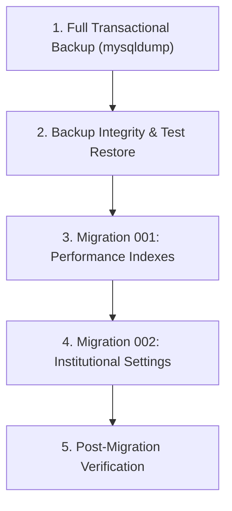

# CIME Campus Management System (CIME CMS)
## Phase 3D: Production Database Readiness Assessment

**Document Version:** 1.0.0  
**Project:** CIME Campus Management System (CIME CMS)  
**Repository:** `E:\CIME-ERP-dev`  
**Branch:** `development`  
**Current HEAD:** `7117cdb446c4d7b3c1c694eed83233fae0c23809`  
**Audit Scope:** Production Database Schema Compatibility, Read-Only Preflight SQL, Migration Execution Sequencing, Administrator Provisioning Safety, and Release Compatibility Analysis.  
**Mode:** Strictly READ-ONLY (no database connections opened, no SQL executed, zero modifications to cloud or repository).

---

## 1. Executive Summary

This Phase 3D assessment provides the definitive, evidence-based database readiness evaluation for deploying CIME CMS to production.

### Key Conclusions:
1. **Zero-Downtime Migration Compatibility:** Both Migration 001 (performance indexes) and Migration 002 (`institutional_settings` singleton table) are strictly additive. The currently deployed legacy backend does not query `institutional_settings`, meaning **database migrations can be executed ahead of code deployment with zero risk or downtime to existing users**.
2. **Migration 001 Idempotency Requirement:** MySQL 8.0 will abort with `ERROR 1061 (ER_DUP_KEYNAME)` if `CREATE INDEX` is run on an existing index name. A preflight inspection or conditional stored procedure is mandatory to handle partially indexed production databases.
3. **Migration 002 Data Preservation:** Migration 002 uses `CREATE TABLE IF NOT EXISTS` and `INSERT IGNORE INTO ... VALUES (1, ...)`. It is 100% repeatable and will never overwrite an existing administrator-configured institutional setting row.
4. **Deployment Sequencing Verified:** The required release order is **Database Migrations -> Backend Deployment -> Frontend Deployment**. The existing frontend on Vercel can safely coexist with the new backend during the deployment window.
5. **Admin Provisioning Governance:** Running `seed.js` in production remains strictly prohibited. A non-destructive `INSERT ... SELECT WHERE NOT EXISTS` procedure is formulated to prevent password clobbering, duplicate administrators, or unverified account states.

---

## 2. Schema Compatibility Matrix (Task 1)

Every table, column, index, foreign key, and constraint required by the new backend application code has been inspected across [`backend/controllers/`](file:///e:/CIME-ERP-dev/backend/controllers/), [`backend/routes/api.js`](file:///e:/CIME-ERP-dev/backend/routes/api.js), [`database/schema.sql`](file:///e:/CIME-ERP-dev/database/schema.sql), and migrations:

| Table | Required Columns & Types | Required Indexes & Unique Keys | Foreign Keys & Cascades | Constraints & Enums | Controllers Referencing Table |
| :--- | :--- | :--- | :--- | :--- | :--- |
| `users` | `id` (VARCHAR 36 PK)<br>`email` (VARCHAR 255)<br>`name` (VARCHAR 100 NULL)<br>`password_hash` (VARCHAR 255)<br>`role` (ENUM)<br>`email_verified` (TINYINT 1)<br>`created_at` (TIMESTAMP) | `PRIMARY KEY (id)`<br>`UNIQUE KEY (email)` | None | `role`: `'admin'`, `'user'`<br>`email_verified`: `0` or `1` | `authController.js`<br>`userController.js`<br>`settingsController.js` |
| `students` | `id` (VARCHAR 36 PK)<br>`name` (VARCHAR 100)<br>`email` (VARCHAR 255)<br>`phone` (VARCHAR 20)<br>`gender` (ENUM)<br>`department` (VARCHAR 50)<br>`semester` (VARCHAR 50)<br>`enroll_date` (DATE)<br>`status` (ENUM)<br>`avatar` (VARCHAR 255)<br>`created_at` (TIMESTAMP) | `PRIMARY KEY (id)`<br>`UNIQUE KEY (email)`<br>`INDEX idx_students_dept_sem (department, semester)`<br>`INDEX idx_students_created (created_at)`<br>`INDEX idx_students_status (status)` | None | `gender`: `'Male'`, `'Female'`, `'Other'`<br>`status`: `'active'`, `'inactive'` | `studentController.js`<br>`attendanceController.js`<br>`reportController.js` |
| `attendance` | `id` (INT AUTO_INCREMENT PK)<br>`student_id` (VARCHAR 36)<br>`date` (DATE)<br>`status` (ENUM)<br>`created_at` (TIMESTAMP) | `PRIMARY KEY (id)`<br>`UNIQUE KEY unique_attendance (student_id, date)`<br>`INDEX idx_attendance_date_status (date, status)` | `FOREIGN KEY (student_id) REFERENCES students(id) ON DELETE CASCADE` | `status`: `'present'`, `'absent'`, `'late'` | `attendanceController.js`<br>`studentController.js`<br>`reportController.js` |
| `grades` | `id` (INT AUTO_INCREMENT PK)<br>`student_id` (VARCHAR 36)<br>`subject` (VARCHAR 100)<br>`score` (INT)<br>`updated_at` (TIMESTAMP) | `PRIMARY KEY (id)`<br>`UNIQUE KEY unique_grade (student_id, subject)` | `FOREIGN KEY (student_id) REFERENCES students(id) ON DELETE CASCADE` | `score`: `CHECK (score >= 0 AND score <= 100)` | `gradesController.js`<br>`studentController.js`<br>`reportController.js` |
| `audit_logs` | `id` (INT AUTO_INCREMENT PK)<br>`user_id` (VARCHAR 36 NULL)<br>`action` (VARCHAR 100)<br>`details` (VARCHAR 500 NULL)<br>`created_at` (TIMESTAMP) | `PRIMARY KEY (id)`<br>`INDEX idx_created (created_at)` | `FOREIGN KEY (user_id) REFERENCES users(id) ON DELETE SET NULL` | None | `audit.js`<br>`auditController.js` |
| `email_verifications` | `id` (INT AUTO_INCREMENT PK)<br>`user_id` (VARCHAR 36)<br>`token_hash` (VARCHAR 64)<br>`expires_at` (DATETIME)<br>`used_at` (DATETIME NULL)<br>`created_at` (TIMESTAMP) | `PRIMARY KEY (id)`<br>`UNIQUE KEY (token_hash)` | `FOREIGN KEY (user_id) REFERENCES users(id) ON DELETE CASCADE` | 64-character SHA-256 hex string | `authController.js` |
| `password_resets` | `id` (INT AUTO_INCREMENT PK)<br>`user_id` (VARCHAR 36)<br>`token_hash` (VARCHAR 64)<br>`expires_at` (DATETIME)<br>`used_at` (DATETIME NULL)<br>`created_at` (TIMESTAMP) | `PRIMARY KEY (id)`<br>`UNIQUE KEY (token_hash)` | `FOREIGN KEY (user_id) REFERENCES users(id) ON DELETE CASCADE` | 64-character SHA-256 hex string | `authController.js` |
| `institutional_settings` *(Migration 002)* | `id` (INT PK DEFAULT 1)<br>`institution_name` (VARCHAR 255)<br>`academic_year` (VARCHAR 50)<br>`time_zone` (VARCHAR 50)<br>`contact_email` (VARCHAR 255)<br>`updated_at` (TIMESTAMP)<br>`updated_by` (VARCHAR 36 NULL) | `PRIMARY KEY (id)` | `FOREIGN KEY (updated_by) REFERENCES users(id) ON DELETE SET NULL` | `CHECK (id = 1)` | `settingsController.js`<br>`reportController.js` |

---

### Schema Uncertainties Requiring Production Preflight Verification
1. **Migration 002 Table Presence:** Has `institutional_settings` already been created in production? (If missing, the new backend returns HTTP 503/500 on all settings and PDF export endpoints).
2. **Migration 001 Index Overlap:** Do any of the 4 performance indexes (`idx_students_dept_sem`, `idx_students_created`, `idx_students_status`, `idx_attendance_date_status`) already exist in production? (If any exist, raw `CREATE INDEX` will throw `ERROR 1061`).
3. **`users.name` Column Presence:** In earlier prototypes, `users` lacked a `name` column. If missing, `SELECT name ...` queries in [`userController.js`](file:///e:/CIME-ERP-dev/backend/controllers/userController.js) will fail.
4. **`users.email_verified` Column Presence:** In legacy databases, `email_verified` did not exist. If missing, login checks in [`authController.js`](file:///e:/CIME-ERP-dev/backend/controllers/authController.js) will fail.
5. **Existing Administrator Accounts:** Does an active administrator account already exist? What is the email address? Is it marked `email_verified = 1`?

---

## 3. Safe Read-Only Database Preflight SQL (Task 2)

The following read-only SQL statements inspect the production database state without altering any schema, data, or locks.

### 3.1 Preflight Query Script
```sql
-- ============================================================================
-- CIME CMS READ-ONLY PRODUCTION DATABASE PREFLIGHT
-- Execute in MySQL Console or MySQL Workbench against production database
-- ============================================================================

-- 1. Check all existing tables in current database:
SELECT 
    table_name AS 'Table Name', 
    engine AS 'Engine', 
    table_rows AS 'Est Rows', 
    table_collation AS 'Collation'
FROM information_schema.tables 
WHERE table_schema = DATABASE()
ORDER BY table_name;

-- 2. Check column signatures on critical tables (verifies name & email_verified):
SELECT 
    table_name AS 'Table', 
    column_name AS 'Column', 
    column_type AS 'Type', 
    is_nullable AS 'Nullable', 
    column_default AS 'Default'
FROM information_schema.columns 
WHERE table_schema = DATABASE()
  AND table_name IN ('users', 'students', 'attendance', 'grades', 'institutional_settings')
ORDER BY table_name, ordinal_position;

-- 3. Check existing index signatures (Migration 001 preflight):
SELECT 
    table_name AS 'Table', 
    index_name AS 'Index Name', 
    non_unique AS 'Non-Unique', 
    GROUP_CONCAT(column_name ORDER BY seq_in_index) AS 'Indexed Columns'
FROM information_schema.statistics 
WHERE table_schema = DATABASE()
  AND table_name IN ('students', 'attendance')
GROUP BY table_name, index_name, non_unique
ORDER BY table_name, index_name;

-- 4. Check foreign key constraints:
SELECT 
    table_name AS 'Table', 
    constraint_name AS 'Constraint', 
    column_name AS 'Column', 
    referenced_table_name AS 'Ref Table', 
    referenced_column_name AS 'Ref Column'
FROM information_schema.key_column_usage 
WHERE table_schema = DATABASE()
  AND referenced_table_name IS NOT NULL
ORDER BY table_name, constraint_name;

-- 5. Check institutional settings table and singleton row (Migration 002 preflight):
-- Note: If table does not exist, this query returns 'Table doesn't exist' (handled safely)
SELECT 
    id, 
    institution_name, 
    academic_year, 
    time_zone, 
    contact_email, 
    updated_at, 
    updated_by 
FROM institutional_settings 
WHERE id = 1;

-- 6. Safe inspection of existing user accounts (NO password hashes or tokens):
SELECT 
    id, 
    email, 
    name, 
    role, 
    email_verified, 
    created_at 
FROM users 
ORDER BY role ASC, created_at ASC;
```

### 3.2 How to Interpret Preflight Results

| Query Output Finding | Meaning | Required Migration Action |
| :--- | :--- | :--- |
| Query 1 does **not** list `institutional_settings` | Migration 002 has not been applied. | **Must execute Migration 002** before deploying backend. |
| Query 3 lists all 4 indexes on `students` & `attendance` | Migration 001 is already applied. | **Skip Migration 001** (or execute idempotent runner). |
| Query 3 lists only some of the 4 indexes | Partial indexes present. | **Execute only the statements for missing indexes**. |
| Query 2 does **not** list `users.name` or `users.email_verified` | Legacy pre-verification schema. | Execute schema alignment: `ALTER TABLE users ADD COLUMN name VARCHAR(100) NULL AFTER email; ALTER TABLE users ADD COLUMN email_verified TINYINT(1) NOT NULL DEFAULT 1;` |
| Query 6 returns an existing account with `role = 'admin'` | Administrator already provisioned. | **Do NOT insert duplicate.** Verify with college whether credentials are known. |
| Query 6 returns 0 accounts with `role = 'admin'` | No administrator account exists. | **Proceed to Section 5** Administrator Provisioning. |

---

## 4. Migration Execution Plan (Task 3)

The execution of database updates must proceed through these exact sequential stages:



### Stage 1: Production Backup
Execute from an administrative shell with MySQL CLI access:
```bash
mysqldump -h <DB_HOST> -P <DB_PORT> -u <DB_USER> -p <DB_NAME> \
  --single-transaction \
  --quick \
  --routines \
  --triggers \
  --hex-blob \
  > cime_backup_pre_release_$(date +%Y%m%d_%H%M%S).sql
```

### Stage 2: Backup Integrity & Verification Restore
1. Confirm dump ended with `-- Dump completed on YYYY-MM-DD HH:MM:SS`.
2. Compute SHA-256 hash: `sha256sum cime_backup_pre_release_*.sql`.
3. Restore into temporary verification database `cime_verify`:
   ```bash
   mysql -h <DB_HOST> -P <DB_PORT> -u <DB_USER> -p -e "CREATE DATABASE cime_verify;"
   mysql -h <DB_HOST> -P <DB_PORT> -u <DB_USER> -p cime_verify < cime_backup_pre_release_*.sql
   ```
4. Verify table row counts match between live and `cime_verify`.
5. Drop verification database: `mysql -h <DB_HOST> -P <DB_PORT> -u <DB_USER> -p -e "DROP DATABASE cime_verify;"`.

### Stage 3: Migration 001 Execution (Performance Indexes)
Using the preflight results from Section 3, execute only the missing index statements:
```sql
USE cohort_erp;

-- Execute only if idx_students_dept_sem is missing:
CREATE INDEX idx_students_dept_sem ON students (department, semester);

-- Execute only if idx_students_created is missing:
CREATE INDEX idx_students_created ON students (created_at);

-- Execute only if idx_students_status is missing:
CREATE INDEX idx_students_status ON students (status);

-- Execute only if idx_attendance_date_status is missing:
CREATE INDEX idx_attendance_date_status ON attendance (date, status);
```

### Stage 4: Migration 002 Execution (Institutional Settings)
Execute directly in MySQL:
```sql
USE cohort_erp;

CREATE TABLE IF NOT EXISTS institutional_settings (
    id INT PRIMARY KEY DEFAULT 1,
    institution_name VARCHAR(255) NOT NULL,
    academic_year VARCHAR(50) NOT NULL,
    time_zone VARCHAR(50) NOT NULL DEFAULT 'Asia/Kolkata',
    contact_email VARCHAR(255) NOT NULL,
    updated_at TIMESTAMP DEFAULT CURRENT_TIMESTAMP ON UPDATE CURRENT_TIMESTAMP,
    updated_by VARCHAR(36) NULL,
    CONSTRAINT fk_inst_settings_updated_by 
        FOREIGN KEY (updated_by) REFERENCES users(id) ON DELETE SET NULL,
    CONSTRAINT chk_singleton_id 
        CHECK (id = 1)
) ENGINE=InnoDB DEFAULT CHARSET=utf8mb4 COLLATE=utf8mb4_unicode_ci;

INSERT IGNORE INTO institutional_settings (id, institution_name, academic_year, time_zone, contact_email)
VALUES (1, 'College of IT and Management Education (CIME)', '2026 – 2027', 'Asia/Kolkata', 'admin@cime.edu');
```

### Stage 5: Post-Migration Verification
```sql
-- Confirm indexes:
SHOW INDEX FROM students WHERE Key_name IN ('idx_students_dept_sem', 'idx_students_created', 'idx_students_status');
SHOW INDEX FROM attendance WHERE Key_name = 'idx_attendance_date_status';

-- Confirm settings:
SELECT id, institution_name, academic_year, time_zone, contact_email, updated_at 
FROM institutional_settings 
WHERE id = 1;
```

---

## 5. Administrator Provisioning Safety (Task 4)

### 5.1 Pre-Provisioning Confirmation Checklist
Before creating or modifying an administrative account, the following items **must be confirmed in writing by the college**:
1. **Primary Admin Email:** The designated official institutional email (e.g. `admin@cime.edu` or institutional domain address).
2. **Authorized Admin Name:** The full name of the authorized system administrator (e.g. `'System Administrator'`).
3. **Existing Account Status:** Confirmation whether this email has ever been registered previously.
4. **Secure Distribution Channel:** An encrypted or out-of-band channel for delivering the generated password directly to the administrator.

### 5.2 Strict Prohibition on `seed.js`
The script [`backend/seed.js`](file:///e:/CIME-ERP-dev/backend/seed.js) must **never** be executed in production. It:
- Hardcodes default passwords to `'password'`.
- Drops or truncates audit logs older than 90 days.
- Injects 6 sample students and mock attendance/grade records.

### 5.3 Safe Provisioning SQL
Execute on the administrative console using a precomputed bcrypt hash (cost factor `10`, offline-generated):

```sql
USE cohort_erp;

-- Safe non-destructive insertion:
-- If admin@cime.edu already exists, 0 rows are inserted, preserving existing passwords.
INSERT INTO users (id, email, name, password_hash, role, email_verified)
SELECT 
    UUID(),
    '<CONFIRMED_ADMIN_EMAIL>',
    '<CONFIRMED_ADMIN_NAME>',
    '<OFFLINE_GENERATED_BCRYPT_HASH>',
    'admin',
    1
WHERE NOT EXISTS (
    SELECT 1 FROM users WHERE email = '<CONFIRMED_ADMIN_EMAIL>'
);

-- Post-insertion verification:
SELECT id, email, name, role, email_verified, created_at 
FROM users 
WHERE email = '<CONFIRMED_ADMIN_EMAIL>';
```
*Verification criteria:* Exactly 1 row returned with `role = 'admin'` and `email_verified = 1`.

---

## 6. Release Compatibility Assessment (Task 5)

### 6.1 Database Dependencies of New Backend
1. **`institutional_settings` Table:** Mandatory. In [`backend/controllers/settingsController.js#L56-L65`](file:///e:/CIME-ERP-dev/backend/controllers/settingsController.js#L56-L65), `getEffectiveSettings()` throws an error if this table is missing, which causes `/settings/*`, `/reports/attendance-sheet`, and PDF exports to return HTTP 503/500.
2. **Performance Indexes:** Strongly recommended for production load. Eliminates 6,000-row table scans during attendance and results lookups.

### 6.2 Backward Compatibility Analysis
- **Can Migrations be Run Before Backend Deploy?**  
  **YES.** Migration 001 adds indexes, which MySQL uses transparently without changing query syntax or data. Migration 002 creates an isolated new table that the old backend never queries. Existing production workflows are unaffected by running migrations in advance.
- **Can Old Frontend Coexist Temporarily with New Backend?**  
  **YES.** The new backend maintains 100% backward compatibility for all existing API contracts (`POST /api/auth/login`, `GET /api/students`, `PUT /api/students/:id/attendance`, `PUT /api/students/:id/grades`). The only change is that public self-registration returns HTTP 403, which is the intended security behavior.
- **Is Backend-First Deployment Appropriate?**  
  **YES.** The safe deployment order is strictly:
  $$\text{Database Migrations} \longrightarrow \text{Backend Deployment (Render)} \longrightarrow \text{Frontend Deployment (Vercel)}$$

### 6.3 Required Environment Variables (Names Only)
The production backend requires the following environment variable names configured in the Render dashboard:
- `NODE_ENV`
- `PORT`
- `FRONTEND_URL`
- `CORS_ORIGIN`
- `JWT_SECRET`
- `DB_HOST`
- `DB_PORT`
- `DB_USER`
- `DB_PASS`
- `DB_NAME`
- `TIME_ZONE`
- `SMTP_HOST` *(optional for login/CRUD; required for reset emails)*
- `SMTP_PORT`
- `SMTP_SECURE`
- `SMTP_USER`
- `SMTP_PASS`
- `SMTP_FROM`

---

## 7. Outstanding Blockers

| Blocker # | Description | Impact | Resolution |
| :---: | :--- | :--- | :--- |
| **B1** | **Migration 002 (`institutional_settings`) table uncreated in production** | Backend routes `/settings/*` and PDF exports fail with HTTP 503. | Execute Migration 002 prior to deploying backend. |
| **B2** | **Render `FRONTEND_URL` environment variable** | Password reset emails contain `http://localhost:5000` links. | Add `FRONTEND_URL=https://cime-erp.vercel.app` in Render settings. |
| **B3** | **Vercel Root Directory configuration** | Vercel fails to serve `index.html` if root is not `frontend`. | Confirm Root Directory is set to `frontend` in Vercel. |
| **B4** | **Production administrator credentials unprovisioned** | Administrator cannot log in after public registration is disabled. | Execute Section 5 non-destructive SQL insert. |

---

## 8. Explicit Approval Gates

Before proceeding with production deployment, written authorization must be recorded for:
- [ ] **Gate A (DBA Approval):** Execution of transactional backup and Migrations 001 and 002 on production MySQL.
- [ ] **Gate B (Security Approval):** Confirmation of the official administrator email and insertion of the initial administrator account.
- [ ] **Gate C (DevOps Approval):** Verification of Render environment variables and Vercel Root Directory configuration.
- [ ] **Gate D (Release Approval):** Authorization to trigger production deployments on Render and Vercel.

---

## 9. Verification Audit & Sign-Off

- **Repository:** `E:\CIME-ERP-dev`
- **Branch:** `development`
- **Current HEAD:** `7117cdb446c4d7b3c1c694eed83233fae0c23809`
- **Working Tree:** Clean (all code tracked and committed; documentation files untracked in `docs/`).
- **Files Inspected:**
  - [`database/schema.sql`](file:///e:/CIME-ERP-dev/database/schema.sql)
  - [`database/migrations/001_performance_indexes.sql`](file:///e:/CIME-ERP-dev/database/migrations/001_performance_indexes.sql)
  - [`database/migrations/002_institutional_settings.sql`](file:///e:/CIME-ERP-dev/database/migrations/002_institutional_settings.sql)
  - [`backend/controllers/authController.js`](file:///e:/CIME-ERP-dev/backend/controllers/authController.js)
  - [`backend/controllers/studentController.js`](file:///e:/CIME-ERP-dev/backend/controllers/studentController.js)
  - [`backend/controllers/attendanceController.js`](file:///e:/CIME-ERP-dev/backend/controllers/attendanceController.js)
  - [`backend/controllers/gradesController.js`](file:///e:/CIME-ERP-dev/backend/controllers/gradesController.js)
  - [`backend/controllers/settingsController.js`](file:///e:/CIME-ERP-dev/backend/controllers/settingsController.js)
  - [`backend/controllers/reportController.js`](file:///e:/CIME-ERP-dev/backend/controllers/reportController.js)
  - [`backend/controllers/userController.js`](file:///e:/CIME-ERP-dev/backend/controllers/userController.js)
  - [`backend/config/db.js`](file:///e:/CIME-ERP-dev/backend/config/db.js)
  - [`backend/routes/api.js`](file:///e:/CIME-ERP-dev/backend/routes/api.js)
  - [`backend/server.js`](file:///e:/CIME-ERP-dev/backend/server.js)
  - [`backend/seed.js`](file:///e:/CIME-ERP-dev/backend/seed.js)
- **Attestation:**
  - Zero production database connections were made.
  - Zero SQL statements were executed against any database.
  - Zero migrations were executed.
  - Zero user accounts were created or modified.
  - Zero seed scripts were run.
  - Zero secrets or `.env` values were accessed or exposed.
  - Zero Render or Vercel configurations were altered.
  - Zero Git commits, pushes, merges, or branch switches were performed.

